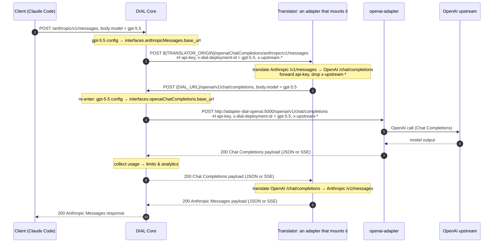

# Anthropic Messages to OpenAI Chat Completions request/response mapping

When DIAL Core serves a Chat Completions deployment under the Anthropic Messages API, it sends `/v1/messages` to this translator, which an adapter mounts with [`mount_translator`](../README.md#anthropic-messages-to-chat-completions-translator). The translator calls the deployment's Chat Completions endpoint on Core and converts the reply back. This page documents how every parameter is translated in both directions.

| Client calls | Translator calls on DIAL Core |
| --- | --- |
| `POST /openaiChatCompletions/anthropic/v1/messages` | `POST {DIAL_URL}/openai/v1/chat/completions` |
| `POST /openaiChatCompletions/legacy/anthropic/v1/messages` | `POST {DIAL_URL}/openai/deployments/{deployment}/chat/completions?api-version={DIAL_API_VERSION}` |
| `POST /openaiChatCompletions/anthropic/v1/messages/count_tokens`, `POST /openaiChatCompletions/legacy/anthropic/v1/messages/count_tokens` | — (404: Chat Completions has no token-counting API) |

Any other path also returns an Anthropic-shaped 404. The two `messages` endpoints translate identically and differ only in the Core API they call: the first uses the Azure OpenAI v1 API, which takes the deployment from the body's `model`, and the second uses the legacy API with the deployment in the path.

## Flow

**Use case:** an Anthropic-native client (e.g. Claude Code) calls `/anthropic/v1/messages` for a model that serves only the OpenAI Chat Completions API, e.g. `gpt-5.5`.

- Core receives `POST /anthropic/v1/messages` with `body.model = gpt-5.5`.
- The deployment declares an `anthropicMessages` interface whose `base_url` points at the translator, so Core forwards the request to `{base_url}/anthropic/v1/messages` and adds these headers:
  - `api-key`: Core's per-request key. The translator forwards it on its call back to Core.
  - `x-dial-deployment-id`: the called deployment. The translator sends it as the Chat Completions `model`.
  - `x-upstream-endpoint`, `x-upstream-key`: upstream settings. The translator drops them.
- The translator converts the request into a Chat Completions body and sends a new request to Core at `{DIAL_URL}/openai/v1/chat/completions`. Core resolves the deployment from the body's `model` and serves it through the deployment's `openaiChatCompletions` interface like any other Chat Completions request, so no translator-specific logic is needed in Core. The legacy endpoint calls `{DIAL_URL}/openai/deployments/{deployment}/chat/completions` instead, with the deployment taken from the `x-dial-deployment-id` header.
- The model's adapter calls the upstream and returns the Chat Completions response. Core collects usage for limits and analytics and passes the response back to the translator.
- The translator converts the response, streaming or not, back into Anthropic Messages shape, and Core returns it to the client.

## Setup

See the [mounting and DIAL Core configuration example](../README.md#anthropic-messages-to-chat-completions-translator).

| Setting | Default | Purpose |
| --- | --- | --- |
| `DIAL_URL` | Unset | DIAL Core base URL. Required: without it every request fails with 500 |
| `DIAL_API_VERSION` | `2025-01-01-preview` | `api-version` sent to Core by the legacy endpoint only |
| `DIAL_SDK_LOG` | `WARNING` | Level of the `aidial_sdk` logger the translator logs to (see [logging](logging.md)). `DEBUG` logs inbound request bodies and outgoing responses or SSE chunks |

The deployment is taken from the `x-dial-deployment-id` header that DIAL Core sets, falling back to the body's `model`.

Only these inbound headers are forwarded to Core, the rest are not:

| Header | Why |
| --- | --- |
| `api-key` | Core's per-request key that authenticates the call back to Core |
| `x-dial-cache-policy` | The prompt caching policy of the request |
| `x-upstream-id` | Pins the request to the same upstream |

## Request: Anthropic → Chat Completions

Neither DIAL Core nor the translator validates the request body against a schema. The translator returns 400 for invalid JSON and for input it cannot translate (see Errors). It doesn't detect any other malformed body, for example a missing or mistyped field: such a request fails with 500. Fields it doesn't read are never checked.

### Top-level parameters

| Anthropic (`/v1/messages`) | Chat Completions | Notes |
| --- | --- | --- |
| `model` | `model` | The `x-dial-deployment-id` header takes precedence over the body |
| `messages` | `messages` | Structurally transformed; see the messages section below |
| `system` (string) | Leading `{"role": "system", "content": "..."}` | An empty string sends nothing |
| `system` (list of content blocks) | Leading `{"role": "system", "content": "..."}` | Text blocks are joined with `\n\n`; other blocks are dropped with a warning |
| `max_tokens` | `max_completion_tokens` | Renamed, never clamped: absent sends no cap, `0` is sent as `0` |
| `temperature` | `temperature` | Passed through as-is |
| `top_p` | `top_p` | Passed through as-is |
| `stop_sequences` | `stop` | Passed through as-is, to every deployment |
| `tools` | `tools` | Format-translated; see the tools section below |
| `tool_choice` | `tool_choice`, `parallel_tool_calls` | Type-remapped; see the tool_choice section below |
| `thinking`, `output_config.effort` | `reasoning_effort` | See the thinking section below |
| `output_config.format` | `response_format` | Wrapped as `{"type": "json_schema", "json_schema": {"name": "response", "schema": ..., "strict": true}}`. Dropped with a warning unless `type` is `json_schema` with a nonempty `schema` |
| `metadata.user_id` | `user` | Passed through untruncated; empty sends nothing |
| `service_tier` | `service_tier` | `auto` → `auto`, `standard_only` → `default`; other values are dropped |
| `cache_control` | `custom_fields.cache_breakpoint` | See the cache_control section below |
| `document` block with `citations.enabled` | `custom_fields.configuration.enable_citations: true` | |
| `stream` | `stream`, `stream_options: {"include_usage": true}` | |
| `top_k`, `compaction`, `context_management`, `mcp_servers`, `container`, `inference_geo` | — | Dropped with a warning |
| — | `store` | Never sent: the management of the state is the responsibility of DIAL Core, so we don't proxy any state-related parameters |

Parameters are forwarded without checking `x-dial-deployment-features`: the target deployment rejects what it doesn't support.

### How messages get converted

All system text is merged into **one leading system message**: the top-level `system`, then every visible `system`-role turn and `mid_conv_system` block in conversation order. Some adapters reject a second system message. `tool_result` blocks become `tool` messages placed before the rest of their turn, and all of a turn's `tool_use` blocks share one assistant message.

| Anthropic message | Chat Completions messages |
| --- | --- |
| `user` role, string content | `{"role": "user", "content": "..."}`; an empty string sends nothing |
| `user` role, content blocks | One `{"role": "tool", ...}` per `tool_result`, then `{"role": "user", "content": [...]}` with the remaining parts |
| `assistant` role, string content | `{"role": "assistant", "content": "..."}`; an empty string sends nothing |
| `assistant` role, content blocks | One `{"role": "assistant", "content": "...", "tool_calls": [...]}` |
| `system` role | Merged into the leading system message |
| `system` role with `clear_at: next_user_message` | Merged only while no later `user` message exists |
| `system` role with `output_config.effort` | The per-turn effort; see the thinking section below |
| Final `assistant` message (prefill) | Sent as ordinary history, not as a prefix to continue |
| Any other role | 400 `invalid_request_error` |

### Content blocks

| Anthropic block | Chat Completions | Notes |
| --- | --- | --- |
| `text` | `{"type": "text", "text": "..."}` part | In an assistant turn, joined with `\n` into `content` |
| `image`, `base64` source | `{"type": "image_url", "image_url": {"url": "data:<media_type>;base64,<data>"}}` | |
| `image`, `url` source | `{"type": "image_url", "image_url": {"url": "<url>"}}` | |
| `image`, `file` source | — | 400 `invalid_request_error`: files uploaded via Anthropic Files API aren't supported |
| `document`, `base64` source | `{"type": "file", "file": {"filename": "<title>", "file_data": "data:..."}}` | Defaults: `document.pdf`, `application/pdf` |
| `document`, `text` source | `{"type": "text", "text": "..."}` | |
| `document`, `content` source | Its text and image blocks as parts | |
| `document`, `url` or `file` source | — | 400 `invalid_request_error`: the `file` part has no URL field, and files uploaded via Anthropic Files API aren't supported |
| `search_result` | `{"type": "text", "text": "<title>\n<source>\n\n<text>"}` | Text blocks are joined with `\n`; citation metadata is lost |
| `tool_result` | `{"role": "tool", "tool_call_id": "...", "content": "..."}` | Text joined with `\n`; `is_error` sends `Error: <text>`. Images and documents move to the following user message; other nested blocks are dropped with a warning |
| `tool_use` | `tool_calls[]`: `{"id": "...", "type": "function", "function": {"name": "...", "arguments": "<JSON string>"}}` | |
| `compaction` (replayed) | Its summary text | A failed compaction (`content: null`) sends nothing |
| `mid_conv_system` | Merged into the leading system message | |
| `thinking`, `redacted_thinking` | — | Dropped: another provider can't verify the signature |
| `server_tool_use`, `web_search_tool_result` | — | Dropped with a warning |
| Any other block | — | Dropped with a warning |

### tools

No tool is ever dropped: a tool the deployment can't run fails the request with the deployment's own error.

| Anthropic tool | Chat Completions tool |
| --- | --- |
| Custom tool (no `type`, or `type: "custom"`) | `{"type": "function", "function": {"name": "...", "description": "...", "parameters": <input_schema>, "strict": <tool's strict>}}` |
| Any other type (`web_search_*`, `bash_*`, `text_editor_*`, `computer_*`, `mcp_toolset`, …) | `{"type": "static_function", "static_function": {"name": "...", "configuration": <the Anthropic tool as sent>}}` |

- `strict` is always sent: `true` only when the tool says so.
- `parameters` drops the schema's root `$schema` key.
- `static_function` is DIAL's slot for provider tools. Only `aidial-adapter-anthropic` reads the Anthropic definition as-is. Its `name` is the tool's `name`, `mcp_server_name` for `mcp_toolset`, or the tool's `type` for a toolset without a name (e.g. `browser_toolset_20260801`).
- A function name that doesn't match `^[a-zA-Z_][a-zA-Z0-9_-]{0,63}$` (for example a long `mcp__…` name) is sent as `<head>_<8 hex of sha256>` in `tools`, `tool_choice` and replayed `tool_calls`, and restored in the response to the same request.

### tool_choice

| Anthropic `tool_choice` | Chat Completions `tool_choice` |
| --- | --- |
| `{"type": "auto"}` | `"auto"` |
| `{"type": "any"}` | `"required"` |
| `{"type": "none"}` | `"none"` |
| `{"type": "tool", "name": "..."}` | `{"type": "function", "function": {"name": "..."}}` |
| `disable_parallel_tool_use: true` / `false` | `parallel_tool_calls: false` / `true` |

### thinking → reasoning_effort

No effort is inferred from `thinking`: `adaptive` and `budget_tokens` name no depth. The first matching row wins.

| Anthropic | `reasoning_effort` |
| --- | --- |
| `thinking.type: "disabled"` | `"none"`, even with an `output_config.effort` |
| `output_config.effort` on the last visible `system` message, else on the request | Passed through as-is |
| An effort other than `none`, `minimal`, `low`, `medium`, `high`, `xhigh`, `max` | 400 `invalid_request_error` |
| Anything else (no `thinking`, `adaptive`, `enabled`, `budget_tokens`) | Not sent: the deployment's default applies |

A `system` turn is visible unless it has `clear_at: next_user_message` and a later `user` message exists. When the last visible `system` turn has no effort, the request's effort applies.

### cache_control

A breakpoint is DIAL's `"custom_fields": {"cache_breakpoint": {}}` on a message, a tool or the request.

| Anthropic | Breakpoint in Chat Completions |
| --- | --- |
| `cache_control` on a `system` block, visible `system`-role turn or `mid_conv_system` block | The merged system message |
| `cache_control` on a block of a user or assistant turn | Every message produced from that turn |
| `cache_control` on a custom tool | That function tool |
| `cache_control` on any other tool | Kept inside the `static_function` configuration |
| Top-level `cache_control` | The request's top-level `custom_fields.cache_breakpoint` |
| `cache_control.ttl` (`5m`, `1h`) | `cache_breakpoint.expire_at`: now + ttl, in UTC. The longest wins when breakpoints merge |

- Breakpoints nested inside a `tool_result` are not inspected.
- An unreadable `ttl` is logged and leaves `expire_at` unset. Without a `ttl`, the Core or provider default applies.
- Breakpoints are sent without a count limit. A breakpoint covers a whole message, so it is coarser than an Anthropic block breakpoint.

## Response: Chat Completions → Anthropic

Only `choices[0]` is translated; other choices are dropped with a warning. Content blocks come out in the order below.

| Chat Completions field | Anthropic response field | Notes |
| --- | --- | --- |
| `id` | `id` | A stream that ends before its first chunk gets a generated UUID |
| — | `model` | Always the requested deployment: the upstream's `model` is not exposed |
| `message.custom_content.state.claude_message_content[]` thinking | `{"type": "thinking", "thinking": "...", "signature": "..."}` | DIAL's native Claude reasoning, with its signature |
| otherwise `message.custom_content.stages[]` named like `think`/`thought`/`reason` | `{"type": "thinking", "thinking": "...", "signature": ""}` | |
| `message.annotations[].url_citation` | `server_tool_use` + `web_search_tool_result` | One pair with every cited URL; `query` is `""` |
| `message.content` | `{"type": "text", "text": "..."}` | |
| `message.refusal` | `{"type": "text", "text": "..."}` | |
| `message.tool_calls[]` | `{"type": "tool_use", "id": "...", "name": "...", "input": {...}}` | `arguments` is JSON-parsed; invalid or non-object JSON becomes `{}`. `custom` calls are skipped with a warning |
| No content at all | `{"type": "text", "text": ""}` | The SDKs index `content[0]` |
| *(hardcoded)* | `type: "message"`, `role: "assistant"` | |
| — | `stop_sequence` | Not set: Chat Completions never says which sequence matched |

`thinking.display` is ignored: thinking text is returned even with `"omitted"`. Omitting it wouldn't make the answer any faster, because the deployment generates and streams the reasoning anyway. Nor is the signature needed, because replayed thinking blocks are dropped. Fields the translator doesn't set are omitted rather than sent as `null`.

### stop_reason

| Condition (first match wins) | `stop_reason` |
| --- | --- |
| `finish_reason: "length"` | `max_tokens`, even with a tool call: it is the one cut off |
| `finish_reason: "content_filter"` | `refusal` |
| Any tool call | `tool_use` |
| A refusal | `refusal` |
| Everything else, including `finish_reason: "stop"` | `end_turn` |

### usage

Anthropic's `input_tokens` excludes cache reads and writes, which `prompt_tokens` includes, so the three input counters add up to `prompt_tokens`.

| Anthropic `usage` | Chat Completions `usage` |
| --- | --- |
| `input_tokens` | `prompt_tokens` − cache read − cache write |
| `cache_read_input_tokens` | `prompt_tokens_details.cached_tokens` |
| `cache_creation_input_tokens` | `prompt_tokens_details.cache_write_tokens` |
| `output_tokens` | `completion_tokens` (includes reasoning) |
| `output_tokens_details.thinking_tokens` | `completion_tokens_details.reasoning_tokens`; `0` when absent |
| `server_tool_use`, `service_tier`, `cache_creation` | Not sent |

Missing or `null` counters count as zero; a response without `usage` reports only zero `input_tokens` and `output_tokens`. If the breakdown exceeds the total, it is capped so the sum still equals `prompt_tokens`.

## Streaming: Chat Completions chunks → Anthropic SSE

The client gets `message_start → (content_block_start → delta* → content_block_stop)* → message_delta → message_stop`.

| Chat Completions chunk | Anthropic events |
| --- | --- |
| First chunk | `message_start` (zero usage) |
| `delta.custom_content.stages[]` thinking text | `thinking` block, `thinking_delta` |
| `delta.custom_content.state.claude_message_content[].signature` | `signature_delta`, then the thinking block closes. A signature after the block closed is dropped with a warning |
| `delta.content`, `delta.refusal` | `text` block, `text_delta` |
| `delta.annotations` with new URLs | `server_tool_use` + `web_search_tool_result` blocks; each URL is sent once per stream |
| `delta.tool_calls[]` with a new `index` | `tool_use` block (`input: {}`) |
| `delta.tool_calls[].function.arguments` | `input_json_delta` |
| `usage` on any chunk | Merged the way DIAL Core merges it |
| End of stream | Open blocks close, then `message_delta` (stop reason, usage) + `message_stop`. Without a `finish_reason` the stop reason comes from the content alone |
| A stream with no content | One empty `text` block |
| An error during the stream | `error` event; see Errors below |

Blocks open one at a time, except parallel tool calls: they stay open together until a text, thinking or citation block opens or the message ends.

## Errors

Every error is Anthropic-shaped: `{"type": "error", "error": {"type": "...", "message": "..."}}`.

| Failure | HTTP status | `error.type` |
| --- | --- | --- |
| Invalid JSON, unknown role, bad effort, `image` with a `file` source, `document` with a `url` or `file` source | 400 | `invalid_request_error` |
| Upstream 400/422, 401, 403, 404, 413, 429 | Same | `invalid_request_error`, `authentication_error`, `permission_error`, `not_found_error`, `request_too_large`, `rate_limit_error` |
| Upstream 503 or 529 | Same | `overloaded_error` |
| Other upstream errors | Same | `api_error` |
| Core unreachable | 502 | `api_error` |
| `DIAL_URL` unset, or an unexpected exception (including a body with a missing or mistyped field) | 500 | `api_error` |

- Upstream error messages are passed through. A 500 carries a generic message; the details go to the server log.
- Before streaming starts, errors are JSON with an HTTP status. Once a stream has started, a failure becomes a final `error` event.
- An error object Core writes into the stream keeps its kind (by its `type` or `code`): `invalid_request_error` stays `invalid_request_error`, `rate_limit_exceeded` becomes `rate_limit_error`, and anything else is `api_error`. A failure inside the translator is `api_error` with a generic message.
